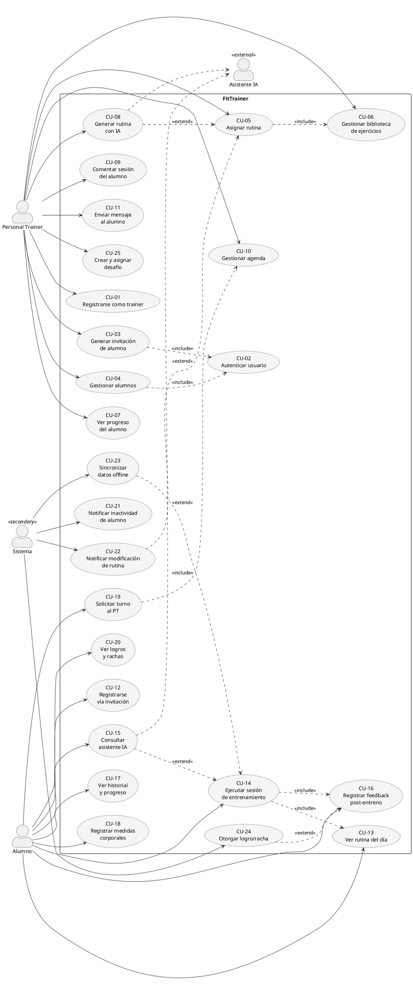

# Diagrama de casos de uso UML

> [!note] Dos páginas en Notion
> En Notion había dos páginas con este diagrama y contenido distinto (numeración de CU diferente), así que se migran las dos, una por sección:
> 1. **Diagrama de casos de uso UML** (24 CU, con trazabilidad a RF y PlantUML) — [Notion](https://app.notion.com/p/33c5ffbef7b581adb17de29b6c4fe3e0)
> 2. **Diagrama de casos de uso (UML)** (13 CU, versión anterior más acotada) — [Notion](https://app.notion.com/p/33c5ffbef7b58176842dc7d3a357a36b)
>
> Las dos tienen fecha de última edición 2026-06-20.

---

# 1. Diagrama de casos de uso UML

Diagrama UML con los actores del sistema y sus casos de uso principales, incluyendo relaciones `«include»` y `«extend»` según la notación UML 2.5.

> **Trazabilidad:** cada caso de uso está vinculado al/los requerimiento(s) funcional(es) que lo originan (columna "RF"). Esto garantiza cobertura completa del MVP.

---

## Actores

| Actor | Tipo | Descripción |
|---|---|---|
| Personal Trainer | Principal | Profesional que gestiona alumnos, arma rutinas y monitorea progreso. Uso típico desde web. |
| Alumno | Principal | Cliente del PT que ejecuta entrenamientos y registra su progreso. Uso típico desde mobile. |
| Sistema | Secundario | Procesos automáticos (cron jobs, notificaciones push, sincronización offline) sin intervención humana. |
| Asistente IA | Secundario (externo) | Servicio de IA (n8n + LLM) que asiste tanto al PT (armado de rutinas) como al alumno (dudas en sesión). |

---

## Casos de uso por actor

### Personal Trainer

| ID | Caso de uso | Descripción | RF |
|---|---|---|---|
| CU-01 | Registrarse como trainer | El PT crea su cuenta con datos profesionales y certificaciones | PT-01 |
| CU-02 | Autenticar usuario | Login con email y contraseña, retorna JWT. Reutilizado por todos los casos de uso protegidos. | PT-01, AL-01 |
| CU-03 | Generar invitación de alumno | Crea un token único que se comparte por WhatsApp o como código QR. Expira en 48 hs. | PT-02 |
| CU-04 | Gestionar alumnos | Ver panel, editar perfil físico, dar de baja, navegar entre alumnos | PT-03, PT-04 |
| CU-05 | Asignar rutina | Crear y asignar plan de entrenamiento con días, ejercicios, series, reps, descanso y tempo | PT-05, PT-12 |
| CU-06 | Gestionar biblioteca de ejercicios | CRUD de ejercicios propios con videos/GIFs + acceso a biblioteca global | PT-06 |
| CU-07 | Ver progreso del alumno | Historial de sesiones, curvas de carga, evolución de medidas, gráficos de progresión | PT-07 |
| CU-08 | Generar rutina con IA | El PT le pasa parámetros del alumno al asistente IA y obtiene una plantilla inicial editable | PT-14 |
| CU-09 | Comentar sesión del alumno | Dejar notas y feedback sobre sesiones completadas del alumno | PT-08 |
| CU-10 | Gestionar agenda | Cargar disponibilidad horaria, aceptar/rechazar turnos solicitados por alumnos | PT-11 |
| CU-11 | Enviar mensaje al alumno | Chat 1 a 1 o broadcast con soporte de texto e imágenes | PT-13 |
| CU-25 | Crear y asignar desafío | Asigna una plantilla (Desafíos → Plantillas → Asignar) o un desafío propio nuevo (metas de sesiones, racha, volumen o peso corporal; premio "Desafío cumplido" opcional, solo la primera vez) a uno o varios alumnos y sigue su progreso desde la ficha | AL-11 |

### Alumno

| ID | Caso de uso | Descripción | RF |
|---|---|---|---|
| CU-12 | Registrarse vía invitación | Acepta link de WhatsApp o escanea QR del PT, confirma datos y elige contraseña | AL-01 |
| CU-13 | Ver rutina del día | Visualiza los ejercicios asignados para el día actual | AL-02 |
| CU-14 | Ejecutar sesión de entrenamiento | Realiza el entrenamiento registrando peso y reps por serie, con timer de descanso | AL-03, AL-04 |
| CU-15 | Consultar asistente IA | Chat para reemplazar ejercicios, consultar técnica o calentamientos durante la sesión | AL-05 |
| CU-16 | Registrar feedback post-entreno | Indica cómo se sintió (RPE 1-10) y nota libre al cerrar la sesión | AL-08 |
| CU-17 | Ver historial y progreso | Consulta sesiones pasadas, evolución de cargas, volumen total y gráficos por ejercicio | AL-06 |
| CU-18 | Registrar medidas corporales | Carga peso y medidas periódicamente para tracking de evolución | AL-07 |
| CU-19 | Solicitar turno al PT | Ver disponibilidad del PT y reservar horario de clase o consulta | AL-12 |
| CU-20 | Ver logros y rachas | Consulta badges obtenidos, racha de días consecutivos y desafíos asignados | AL-11 |

### Sistema (actor secundario)

| ID | Caso de uso | Descripción | RF |
|---|---|---|---|
| CU-21 | Notificar inactividad de alumno | Job que detecta alumnos que no entrenaron en N días y notifica al PT | PT-09 |
| CU-22 | Notificar modificación de rutina | Cuando el alumno cambia series/reps/peso o sustituye un ejercicio, avisa al PT | PT-09 |
| CU-23 | Sincronizar datos offline | Detecta retorno de conectividad y sincroniza las sesiones registradas localmente | AL-10 |
| CU-24 | Otorgar logro/racha | Evalúa al cerrar sesión si corresponde otorgar un badge, racha o cumplimiento de desafío | AL-11 |

---

## Relaciones entre casos de uso

| Origen → Destino | Tipo | Justificación |
|---|---|---|
| CU-04 → CU-02 | `«include»` | Toda gestión de alumnos requiere autenticación previa (representativo de todos los CU protegidos) |
| CU-05 → CU-06 | `«include»` | Asignar rutina siempre requiere acceder a la biblioteca de ejercicios para seleccionar ítems |
| CU-14 → CU-13 | `«include»` | Ejecutar sesión siempre parte de ver la rutina del día |
| CU-14 → CU-16 | `«include»` | Al cerrar la sesión siempre se ofrece el feedback (RPE + nota), que el alumno puede saltear. Viaja en el `POST` de la sesión, o en un `PATCH` si la sesión ya subió |
| CU-03 → CU-02 | `«include»` | Generar invitación requiere que el PT esté autenticado |
| CU-05 → CU-08 | `«extend»` | El PT puede opcionalmente partir de una rutina generada por la IA antes de personalizarla |
| CU-14 → CU-15 | `«extend»` | Consultar al asistente IA durante la sesión es opcional (depende de duda del alumno) |
| CU-14 → CU-23 | `«extend»` | Si la sesión se ejecutó offline, al recuperar conexión se dispara la sincronización |
| CU-16 → CU-24 | `«extend»` | Tras el feedback, el Sistema evalúa si corresponde otorgar logro, racha o badge |
| CU-05 → CU-22 | `«extend»` | Si el alumno modifica la rutina asignada, el Sistema notifica al PT (flujo condicional) |
| CU-19 → CU-10 | `«include»` | Solicitar turno requiere consultar la agenda del PT para ver slots disponibles |

---

## Diagrama PlantUML

El siguiente código renderiza el diagrama completo en cualquier herramienta PlantUML (VS Code, [plantuml.com](http://plantuml.com), IntelliJ, etc.):

---

## Convenciones UML aplicadas

- **Línea sólida** entre actor y caso de uso → asociación directa.
- **Flecha punteada con `«include»`** → el CU base **siempre** ejecuta el CU incluido (dependencia obligatoria).
- **Flecha punteada con `«extend»`** → el CU extendido se ejecuta **opcionalmente** bajo cierta condición (flujo alternativo).
- **Rectángulo "FitTrainer"** → límite del sistema (system boundary). Todo lo que está dentro forma parte del sistema; los actores quedan afuera.
- **Actor "Sistema"** → procesos automáticos internos (cron, jobs, eventos), sin intervención humana directa.
- **Actor "Asistente IA"** → servicio externo (n8n + LLM) consumido por CU-08 y CU-15.

> **Nota sobre la dirección de `«extend»`:** en UML 2.x la flecha va desde el CU extensor hacia el CU base. Por eso CU-08 (Generar rutina con IA) extiende a CU-05 (Asignar rutina), no al revés.

---

# 2. Diagrama de casos de uso (UML)

Diagrama UML con los tres actores del sistema y sus casos de uso, incluyendo relaciones `«include»` y `«extend»`.

---

## Actores

| Actor | Tipo | Descripción |
|---|---|---|
| Personal Trainer | Principal | Usa la app web para gestionar alumnos, rutinas y progreso |
| Alumno | Principal | Usa la app mobile para entrenar y registrar su progreso |
| Sistema | Secundario | Ejecuta procesos automáticos (cron jobs, notificaciones push) |

---

## Casos de uso por actor

### Personal Trainer

| ID | Caso de uso | Descripción |
|---|---|---|
| CU-01 | Registrarse como trainer | El PT crea su cuenta con datos personales y profesionales |
| CU-02 | Iniciar sesión | Autenticación con email y contraseña, obtención de JWT |
| CU-03 | Generar QR de invitación | Crea un QR único por alumno con datos precargados, expira en 48hs |
| CU-04 | Gestionar alumnos | Ver lista, perfil físico, historial y estado de cada alumno |
| CU-05 | Asignar rutina | Crear y asignar un plan de entrenamiento personalizado al alumno |
| CU-06 | Gestionar biblioteca | Crear, editar y organizar ejercicios propios y globales |
| CU-07 | Ver progreso del alumno | Ver historial de sesiones, curvas de carga y evolución de medidas |

### Alumno

| ID | Caso de uso | Descripción |
|---|---|---|
| CU-08 | Registrarse vía QR | Escanea el QR del PT y crea su cuenta con datos precargados |
| CU-09 | Ver rutina del día | Consulta los ejercicios asignados para la jornada de hoy |
| CU-10 | Ejecutar sesión | Registra series, pesos reales y reps durante el entrenamiento |
| CU-11 | Consultar asistente IA | Pide al chat IA alternativas de ejercicio o consejos de técnica |
| CU-12 | Registrar medidas | Carga peso corporal y medidas antropométricas periódicamente |

### Sistema

| ID | Caso de uso | Descripción |
|---|---|---|
| CU-13 | Enviar alerta inactividad | Job nocturno que detecta alumnos sin sesión en N días y notifica al PT |

---

## Relaciones entre casos de uso

| Relación | Tipo | Descripción |
|---|---|---|
| CU-05 → CU-06 | `«include»` | Asignar rutina siempre requiere acceder a la biblioteca de ejercicios |
| CU-10 → CU-09 | `«include»` | Ejecutar sesión siempre parte de ver la rutina del día |
| CU-10 → CU-11 | `«extend»` | Consultar el asistente IA es opcional dentro de una sesión activa |
| CU-08 → CU-02 | `«include»` | Al completar el registro vía QR el alumno queda autenticado automáticamente |

---

## Convenciones UML

- **Actor** — entidad externa que interactúa con el sistema (representado como figura humana)
- **Caso de uso** — funcionalidad del sistema desde la perspectiva del actor (representado como elipse)
- **`«include»`** — el caso de uso base siempre ejecuta el caso incluido (obligatorio)
- **`«extend»`** — el caso de uso extensor se ejecuta solo bajo ciertas condiciones (opcional)
- **Boundary** — rectángulo que delimita el sistema y separa lo interno de los actores externos
